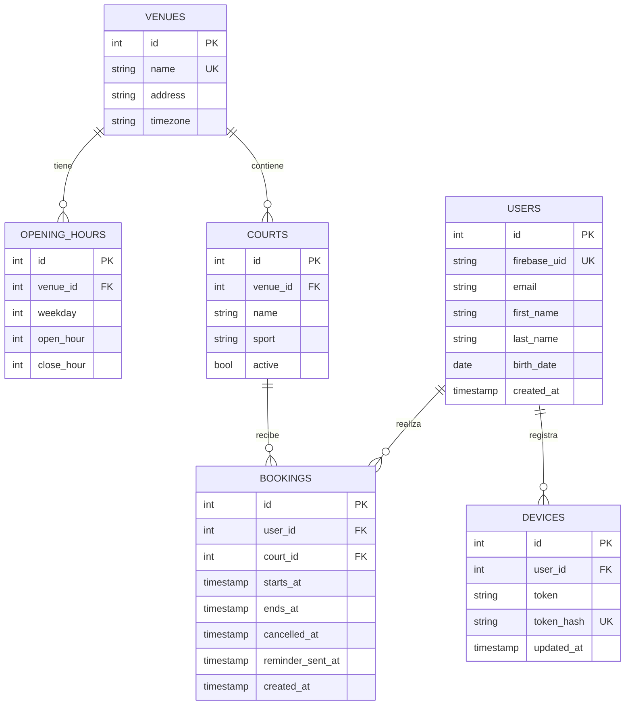

# Modelo de datos de ClubNestorArakaki

El esquema real está en `backend/app/models.py` y sus migraciones Alembic.
Firebase Authentication almacena las contraseñas; PostgreSQL almacena el perfil
y la información del club. No hay contraseña en la tabla `users`.

| Entidad | Atributos y propósito |
| --- | --- |
| `venues` | `id` identifica; `name` es único; `address` es la dirección; `timezone` contiene la zona IANA de la sede. |
| `opening_hours` | `venue_id` vincula la sede; `weekday` usa lunes=0 a domingo=6; `open_hour`/`close_hour` son horas enteras y 24 representa medianoche. Una fila por sede/día, sin fila = cerrado. |
| `courts` | `venue_id` es la sede; `name` conserva la etiqueta local usada por la precarga; `sport` es el tipo; `active` permite conservar referencias del historial sin ofrecer esa cancha para reservar. |
| `users` | `firebase_uid` vincula con Firebase y es único. `email` viene del token firmado, no de PATCH. Nombres y fecha pueden estar vacíos hasta completar el perfil. |
| `bookings` | Identifica usuario, cancha e intervalo. `cancelled_at` nulo significa confirmada; `reminder_sent_at` nulo significa sin recordatorio aceptado. `created_at` conserva la fecha de creación. Fechas de reserva en TIMESTAMPTZ. |
| `devices` | Token real FCM por dispositivo; `token_hash` SHA-256 es un índice único pequeño para no indexar directamente un token largo. La huella no reemplaza el token que FCM necesita. |

Una sede puede tener varias canchas y horarios; cada cancha pertenece a una sola
sede. Un usuario puede tener varias reservas y dispositivos. Cada reserva tiene
un solo propietario y una sola cancha. Se conservan las filas canceladas para el
historial. No hay entidades de pagos, administradores ni reportes.

## Nombre académico del espacio

La propiedad `Court.full_name` produce el nombre que `CourtSchema` devuelve en
el campo REST `name`: **sede_dirección_tipo_número**. Ejemplo con datos hipotéticos:
`Moron_Rivadavia_19850_Paddle_1`. Se eliminan tildes y se sustituyen separadores
por `_`; el número es el ID estable de la cancha, global, sin reiniciarlo por sede.
La API calcula el nombre usando los datos reales relacionados; Flutter no lo
inventa ni fija nombres de sedes en su código.

Se conserva `courts.name` como etiqueta local interna para que las precargas
anteriores sigan siendo idempotentes. No se duplicaron sede/dirección dentro de
cada fila ni se renumeraron canchas con reservas existentes. Los nombres
compuestos también se obtienen al consultar una cancha inactiva para el historial.

## Restricciones que sostienen los requisitos

- FK: no puede existir una cancha sin sede o una reserva sin usuario/cancha.
- Horarios: `0 <= open_hour < close_hour <= 24`; día de semana entre 0 y 6.
- Reserva: fin posterior al inicio y duración real de 1–24 horas enteras.
  La API exige comienzo futuro, minuto/segundo cero y encaje en la apertura.
- Exclusión PostgreSQL GiST: para la misma cancha, dos reservas sin cancelar no
  pueden superponerse. Se usa el intervalo `[inicio, fin)`: dos turnos consecutivos
  sí son válidos. `btree_gist` es una extensión de PostgreSQL, no otro servicio.
- `status` es calculado, no una segunda columna que pudiera contradecir la cancelación.
- El recordatorio toma un bloqueo de fila hasta guardar su marca; no depende de
  una variable Python que se perdería al suspender Render.

Las migraciones crean/modifican el esquema versionado. La migración `1003` agrega
sólo la marca del recordatorio; `full_name` es calculado y no necesita migración.
`seed` carga sedes, horarios y canchas de forma idempotente; no borra reservas ni
cambia los datos que el usuario ya hubiera cargado.
